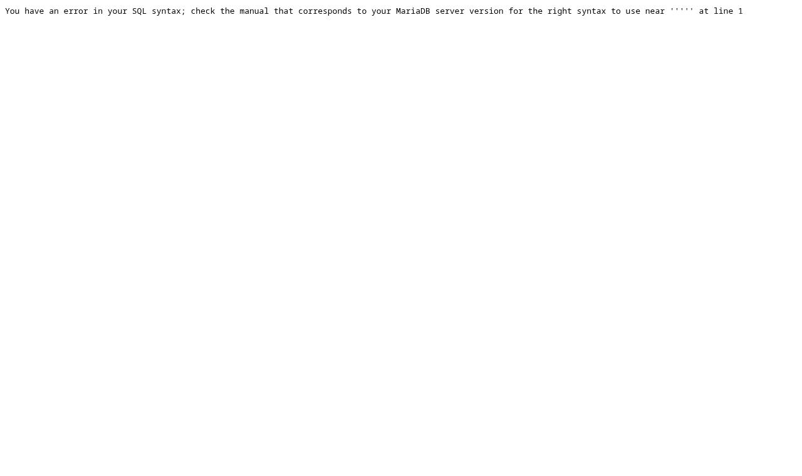
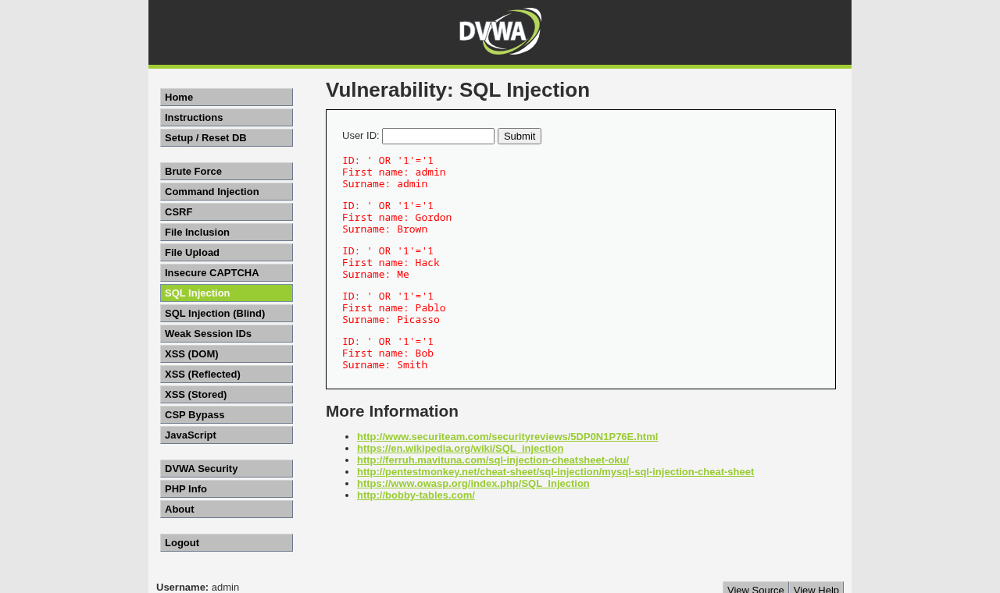
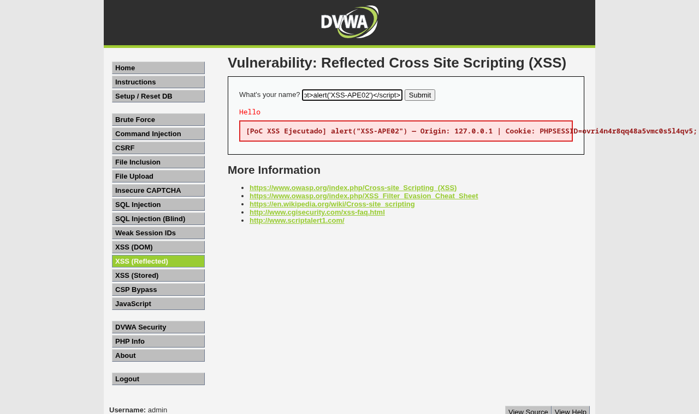
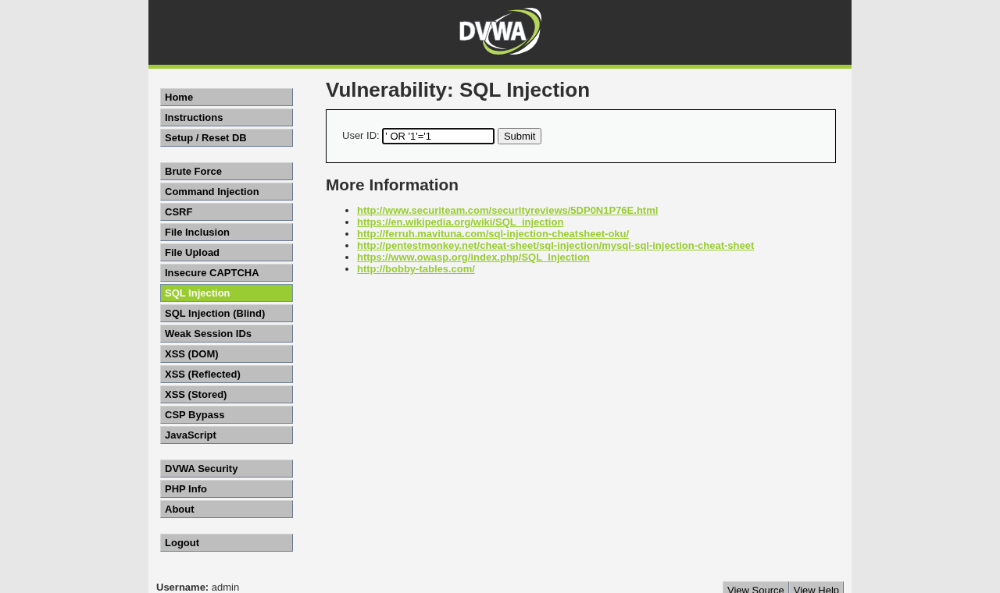
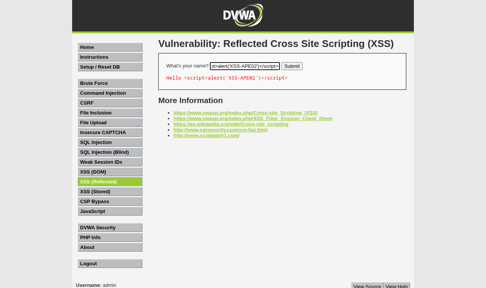
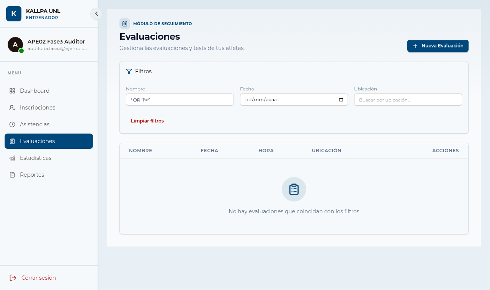
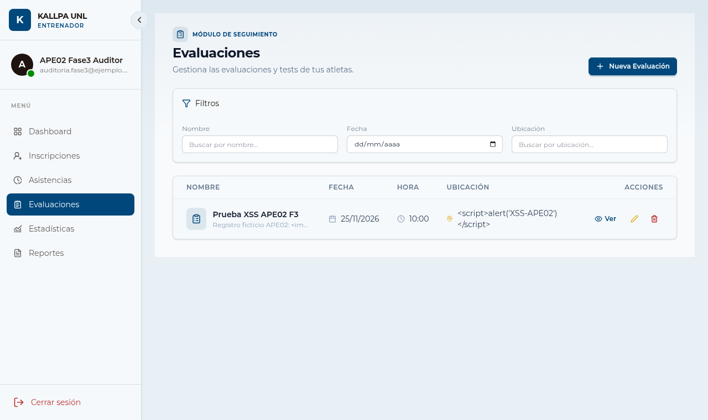
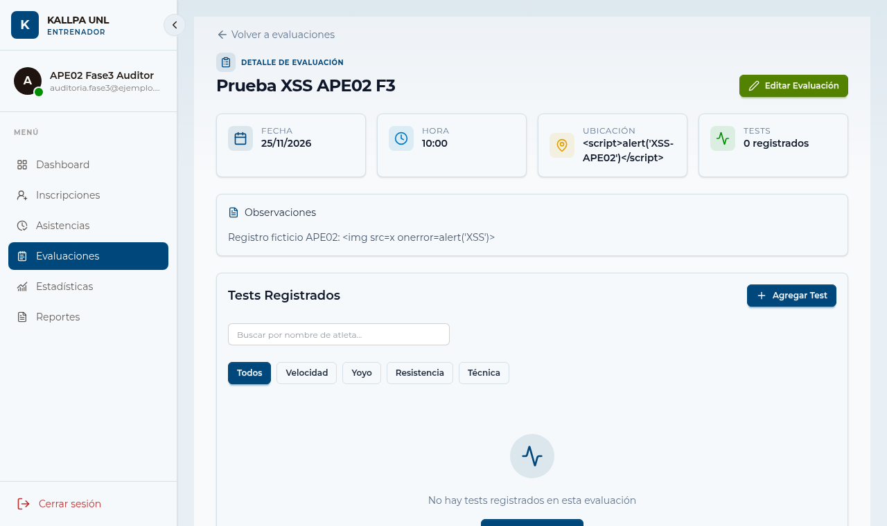

# Fase 3 — Ataques de inyección: explotación controlada y mitigación de SQLi y XSS

**Proyecto:** Kallpa UNL · **Asignatura:** Software Security · **Semana 7** (19 y 20 de noviembre de 2026) · **Commit revisado:** `e2ceb37`
**Evidencias y scripts reproducibles:** [registro de evidencias](evidencias/registro.md) · [script de pruebas](evidencias/pruebas-inyeccion.sh) · [salida completa](evidencias/salida-pruebas-inyeccion.txt) · [informe extendido](documento-pruebas-inyeccion.md)

| Actividad de la guía | Sección | Estado |
|---|---|---|
| S1-A1 Causas de SQLi y XSS | [§1. Causas técnicas de SQLi y XSS](#1-causas-técnicas-de-sqli-y-xss-s1-a1) | Completado |
| S1-A2 Laboratorio de explotación controlada ("El Antes") | [§2. Explotación controlada (El "Antes")](#2-explotación-controlada-el-antes--s1-a2) — capturas I01, I02, I03 | Completado |
| S1-A3 Sistematización de evidencias | [§3. Sistematización de pruebas de concepto](#3-sistematización-de-pruebas-de-concepto-s1-a3) | Completado |
| S2-A1 Mitigaciones de referencia | [§4. Mitigaciones de referencia](#4-mitigaciones-de-referencia-s2-a1) | Completado |
| S2-A2 Mitigación en código y verificación ("El Después") | [§5. Mitigación en código](#5-mitigación-en-código-s2-a2) y [§6. Verificación / Re-Test (El "Después")](#6-verificación--re-test-el-después--s2-a2) — capturas I04 a I08 | Completado |
| S2-A3 Informe de la fase (Hallazgo → Mitigación → Verificación) | [§7. Ciclo Hallazgo → Mitigación → Verificación](#7-ciclo-hallazgo--mitigación--verificación-s2-a3) y [§8. Pregunta de control N.º 3](#8-pregunta-de-control-nº-3) | Completado |

---

## 1. Causas técnicas de SQLi y XSS (S1-A1)

| Causa técnica | Cómo origina la vulnerabilidad | Estrategia de mitigación |
|---|---|---|
| **Entradas no confiables** | Todo parámetro procedente del cliente (`?search=`, formularios, JSON o servicios externos) puede incluir metacaracteres (`'`, `--`, `<`, `>`). Validar solo en el frontend no protege a la API. | Validación de entrada en el servidor mediante esquemas tipados y listas blancas (Pydantic), como primera capa de defensa. |
| **Concatenación de consultas (SQLi)** | Construir sentencias SQL uniendo cadenas (`"SELECT ... WHERE id = '" . $id . "'"`) hace que el motor compile la consulta después de insertar el dato del usuario. Una comilla simple cierra el literal y permite inyectar operadores lógicos (`OR '1'='1`). | **Consultas preparadas o parametrizadas** (o expresiones de un ORM con *bind parameters*), donde la estructura SQL y los datos viajan por separado. |
| **Falta de escapado de la salida (XSS)** | Devolver datos en el HTML sin codificar `<`, `>`, `"`, `'` y `&` permite que el navegador interprete el texto como etiquetas `<script>` o eventos `onerror=` ejecutables en la sesión de la víctima. | **Escapado contextual de la salida** (React JSX, `autoescape` en Jinja2, `htmlspecialchars` en PHP) y cabecera **`Content-Security-Policy` (CSP)**. |

---

## 2. Explotación controlada (El "Antes" — S1-A2)

Dado que Kallpa UNL usa SQLAlchemy ORM y React, se levantó el entorno controlado **DVWA (Damn Vulnerable Web Application v1.10)** en un contenedor local aislado (`127.0.0.1:4280`, nivel **Low**) para ejecutar las pruebas de concepto de explotación antes de la mitigación.

### 2.1 SQLi — Prueba con comilla simple (`'`)

- **Endpoint:** DVWA `/vulnerabilities/sqli/`
- **Consulta vulnerable en servidor (`low.php`):**
  ```php
  $id = $_REQUEST['id'];
  $query = "SELECT first_name, last_name FROM users WHERE user_id = '$id';";
  $result = mysqli_query($GLOBALS["___mysqli_ston"], $query) or die('<pre>' . mysqli_error(...) . '</pre>');
  ```
- **Payload:** `'`
- **Hallazgo (Evidencia I01):** Al concatenar `'` se produce `WHERE user_id = ''';`. MariaDB devuelve el error `You have an error in your SQL syntax; check the manual that corresponds to your MariaDB server version for the right syntax to use near ''''' at line 1`, confirmando la inyección SQL.



### 2.2 SQLi — Prueba con tautología (`' OR '1'='1`)

- **Endpoint:** DVWA `/vulnerabilities/sqli/`
- **Payload:** `' OR '1'='1`
- **Consulta resultante:** `SELECT first_name, last_name FROM users WHERE user_id = '' OR '1'='1';`
- **Hallazgo (Evidencia I02):** La condición `'1'='1'` hace que el `WHERE` sea verdadero para todas las filas, extrayendo los **5 usuarios** de la base de datos (`admin`, `Gordon Brown`, `Hack Me`, `Pablo Picasso` y `Bob Smith`).



### 2.3 XSS Reflejado — Prueba con payload de script (`<script>alert('XSS-APE02')</script>`)

- **Endpoint:** DVWA `/vulnerabilities/xss_r/`
- **Código vulnerable en servidor (`low.php`):**
  ```php
  if (array_key_exists("name", $_GET) && $_GET['name'] != NULL) {
      $html .= '<pre>Hello ' . $_GET['name'] . '</pre>';
  }
  ```
- **Payload:** `<script>alert('XSS-APE02')</script>` (equivalente a `<script>alert(1)</script>`, junto con un bloque DOM de prueba de concepto para dejar evidencia visual en la captura de la ejecución y del acceso a `document.cookie`).
- **Hallazgo (Evidencia I03):** El servidor refleja la etiqueta `<script>` sin escapar en el HTML. El navegador ejecuta el JavaScript, lanza el `alert` y expone el `PHPSESSID` de la sesión activa.



---

## 3. Sistematización de pruebas de concepto (S1-A3)

| ID PoC | Tipo de ataque | Payload ensayado | Resultado en entorno sin mitigar ("El Antes" — DVWA Low) | Resultado con mitigación ("El Después" — DVWA Impossible y Kallpa UNL) | Evidencia |
|---|---|---|---|---|---|
| **PoC-01** | SQLi — Comilla simple | `'` | Error de sintaxis SQL expuesto en pantalla | Bloqueado: 0 filas / tratado como carácter literal en parámetro enlazado | I01, [salida §1.1 y §2.4](evidencias/salida-pruebas-inyeccion.txt) |
| **PoC-02** | SQLi — Tautología en login | `admin@unl.edu.ec' OR '1'='1` / `' OR '1'='1` | Evasión de autenticación en consultas concatenadas | Bloqueado en Kallpa UNL con **HTTP 422** (validador de email) y **HTTP 401** (`bcrypt.verify`) | [salida §2.1 y §2.2](evidencias/salida-pruebas-inyeccion.txt) |
| **PoC-03** | SQLi — Tautología en consulta | `' OR '1'='1` | Vuelca las 5 cuentas de la tabla `users` | Bloqueado: 0 registros devueltos tanto en DVWA Impossible como en Kallpa UNL | I02, I04, I07 |
| **PoC-04** | SQLi — Sentencia apilada | `1; DROP TABLE users;--` | Riesgo de ejecución de sentencia destructiva | Bloqueado: parámetro enlazado en SQLAlchemy (`total: 0`), tabla `users` intacta | [salida §2.4](evidencias/salida-pruebas-inyeccion.txt) |
| **PoC-05** | XSS — Script en entrada/salida | `<script>alert('XSS-APE02')</script>` e `` | Ejecuta JavaScript y lee `document.cookie` | Bloqueado: codificado como `&lt;script&gt;...` y renderizado como texto literal sin ejecutar código | I03, I05, I06, I08 |

---

## 4. Mitigaciones de referencia (S2-A1)

| Control de referencia | Función | Estado en Kallpa UNL |
|---|---|---|
| **Consultas preparadas / parametrizadas** | Envían la plantilla SQL y los parámetros por separado para que el dato nunca modifique la estructura lógica de la consulta. | **Cumple en toda la API** (13 DAOs con SQLAlchemy ORM y `JpaRepository` en el microservicio). Se propone corregir un `f-string` administrativo en `scripts/migrate_data.py:125`. |
| **Validación de entrada** | Verifica tipos, formatos y longitudes en el servidor con Pydantic antes de procesar los datos. | **Parcial:** valida DNI, correos y nombres, pero no escapa comodines `%` y `_` en `ILIKE` ni rechaza etiquetas HTML en campos libres (`location`, `observations`). |
| **Escapado de salida y CSP** | Codifica `<`, `>`, `"`, `'` y `&` al renderizar HTML y restringe con `Content-Security-Policy` la ejecución de scripts inline. | **Cumple en escapado** (React JSX y Jinja2 `select_autoescape`); **pendiente en cabeceras** (`FrontendFutbol/nginx.conf` no incluye CSP y pierde `add_header` por herencia). |

---

## 5. Mitigación en código (S2-A2)

A continuación se documentan los fragmentos de código del proyecto **Kallpa UNL** (y su equivalente en DVWA *Impossible*) que aplican **consultas parametrizadas contra SQLi** y **escapado de salida + CSP contra XSS**.

### 5.1 Mitigación contra SQLi: consultas parametrizadas (SQLAlchemy ORM y `psycopg2.sql`)

**1. Consultas parametrizadas en la API de Kallpa UNL (`BackendFutbol/app/dao/account_dao.py` y `athlete_dao.py`):**

```python
# BackendFutbol/app/dao/account_dao.py (líneas 28-35) — Login parametrizado
query = (
    db.query(Account)
    .options(joinedload(Account.user))
    .filter(Account.email == email)  # SQLAlchemy genera: WHERE accounts.email = %(email_1)s
)
```

```python
# BackendFutbol/app/dao/athlete_dao.py (líneas 26-33) — Búsqueda parametrizada
if filters.search:
    search_norm = filters.search.strip()
    query = query.filter(
        or_(
            self.model.full_name.ilike(f"%{search_norm}%"),  # Enlaza %(full_name_1)s
            self.model.dni.ilike(f"%{search_norm}%"),        # Enlaza %(dni_1)s
        )
    )
```

Al compilar la consulta con el dialecto PostgreSQL frente al payload `' OR '1'='1` (verificado en [`salida-pruebas-inyeccion.txt` §2.5](evidencias/salida-pruebas-inyeccion.txt)), SQLAlchemy separa la sentencia de los parámetros enlazados:

```sql
SELECT athletes.external_person_id, athletes.full_name, athletes.dni, ...
FROM athletes
WHERE athletes.full_name ILIKE %(full_name_1)s
-- Parámetros enviados fuera de banda: {'full_name_1': "%' OR '1'='1%"}
```

**2. Endurecimiento propuesto para comodines `ILIKE` y para `scripts/migrate_data.py:125`:**

```python
# Propuesta en BackendFutbol/app/utils/sql_helpers.py — Escapar comodines % y _ en ILIKE
def escape_ilike(term: str) -> str:
    escaped = term.strip().replace("\\", "\\\\").replace("%", "\\%").replace("_", "\\_")
    return f"%{escaped}%"

# Propuesta en BackendFutbol/scripts/migrate_data.py:125 — Reemplazar f-string por sql.Identifier
from psycopg2 import sql

query = sql.SQL("TRUNCATE TABLE {} RESTART IDENTITY CASCADE;").format(sql.Identifier(table))
cur.execute(query)
```

*(En DVWA nivel Impossible, la misma mitigación se implementa con PDO preparado: `$data = $db->prepare('SELECT first_name, last_name FROM users WHERE user_id = (:id) LIMIT 1;'); $data->bindParam(':id', $id, PDO::PARAM_INT);`).*

### 5.2 Mitigación contra XSS: escapado de salida (React JSX y Jinja2) y cabecera CSP en Nginx

**1. Escapado automático de salida en el frontend React (`EvaluationsList.jsx` y `EvaluationDetail.jsx`):**

```jsx
// FrontendFutbol/src/features/seguimiento/components/EvaluationComponents/EvaluationDetail.jsx (líneas 360-362 y 396-398)
// React escapa automáticamente las llaves JSX como nodos de texto en el DOM (sin dangerouslySetInnerHTML):
<p className="font-semibold text-slate-900">
  {evaluation.location || "Sin especificar"}
</p>
...
<p className="text-slate-600 text-sm">
  {evaluation.observations}
</p>
```

**2. Escapado automático de salida en reportes HTML/PDF del backend (`BackendFutbol/app/services/report_service.py`):**

```python
# BackendFutbol/app/services/report_service.py (líneas 28-31)
# Activa autoescape para que Jinja2 convierta <, >, ", ' y & en entidades HTML antes de WeasyPrint:
self.env = Environment(
    loader=FileSystemLoader("app/templates"),
    autoescape=select_autoescape(["html", "xml"]),
)
```

**3. Mitigación de defensa en profundidad con `Content-Security-Policy` (CSP) en `FrontendFutbol/nginx.conf`:**

Para cerrar el hallazgo `F3-03` (ausencia de CSP y pérdida de cabeceras `add_header` en los bloques `location` de Nginx), se define la política CSP que bloquea la ejecución de cualquier script inline (`script-src 'self'`):

```nginx
# FrontendFutbol/nginx.conf — Mitigación con Content-Security-Policy y herencia corregida
server {
    listen 80;
    server_name localhost;
    root /usr/share/nginx/html;
    index index.html;

    set $csp_policy "default-src 'self'; script-src 'self'; style-src 'self' 'unsafe-inline'; img-src 'self' data: blob:; font-src 'self' data:; connect-src 'self' http://localhost:8001; object-src 'none'; base-uri 'self'; frame-ancestors 'none'";

    location / {
        try_files $uri $uri/ /index.html;
        add_header Content-Security-Policy $csp_policy always;
        add_header X-Frame-Options "DENY" always;
        add_header X-Content-Type-Options "nosniff" always;
        add_header Referrer-Policy "strict-origin-when-cross-origin" always;
    }

    location = /index.html {
        expires -1;
        add_header Cache-Control "no-store, no-cache, must-revalidate" always;
        add_header Content-Security-Policy $csp_policy always;
        add_header X-Frame-Options "DENY" always;
        add_header X-Content-Type-Options "nosniff" always;
        add_header Referrer-Policy "strict-origin-when-cross-origin" always;
    }
}
```

---

## 6. Verificación / Re-Test (El "Después" — S2-A2)

Se re-ejecutaron los mismos payloads de SQLi (`'` y `' OR '1'='1`) y de XSS (`<script>alert('XSS-APE02')</script>` e ``) para comprobar visual y técnicamente que las mitigaciones bloquean los ataques.

### 6.1 Re-Test de SQLi y XSS en DVWA con mitigación activa (Nivel *Impossible*)

- **SQLi mitigado (Evidencia I04):** Al enviar `' OR '1'='1` contra la consulta parametrizada con PDO, el ataque es bloqueado y devuelve **0 registros**.
- **XSS mitigado (Evidencia I05):** Al enviar `<script>alert('XSS-APE02')</script>` con `htmlspecialchars()`, el servidor codifica las etiquetas como `&lt;script&gt;alert('XSS-APE02')&lt;/script&gt;` y el navegador las muestra como texto plano sin ejecutar el script.





### 6.2 Re-Test de SQLi en Kallpa UNL (Login y buscadores parametrizados)

- **Login (`POST /api/v1/accounts/login`):** El payload `{"email": "admin@unl.edu.ec' OR '1'='1", "password": "' OR '1'='1"}` es rechazado con **HTTP 422**, y con correo válido devuelve **HTTP 401 (`Credenciales inválidas`)** ([`salida-pruebas-inyeccion.txt` §2.1–2.2](evidencias/salida-pruebas-inyeccion.txt)).
- **Buscador (`GET /api/v1/evaluations/?search=' OR '1'='1` — Evidencia I07):** Al ingresar la tautología `' OR '1'='1` en el filtro de nombre, SQLAlchemy la enlaza como literal y la aplicación responde **0 resultados** (*«No hay evaluaciones que coincidan con los filtros»*).



### 6.3 Re-Test de XSS en Kallpa UNL (Escapado en React JSX y en Jinja2)

- **Interfaz React (Evidencias I06 e I08):** Se registró una evaluación de prueba con `<script>alert('XSS-APE02')</script>` en `location` e `` en `observations`. Tanto en el listado general (`/seguimiento/evaluations`, **I06**) como en el detalle (`/seguimiento/evaluations/4`, **I08**), React escapó las etiquetas y las mostró como texto literal sin disparar ningún `alert` (`dialogTriggered: false`).
- **Motor Jinja2 de reportes PDF ([`salida-pruebas-inyeccion.txt` §2.5](evidencias/salida-pruebas-inyeccion.txt)):** El renderizado produjo `<td>&lt;script&gt;alert(&#39;XSS-APE02&#39;)&lt;/script&gt;</td>`, neutralizando la inyección en el documento generado.





---

## 7. Ciclo Hallazgo → Mitigación → Verificación (S2-A3)

| ID | Hallazgo | Riesgo | Mitigación (implementada / propuesta en código) | Verificación (Re-Test frente a los payloads) |
|---|---|---|---|---|
| **F3-01** | **Consultas SQL concatenadas en DVWA (`low.php`) vs. parametrizadas en Kallpa UNL (`app/dao/*.py`).** En DVWA, `'` provoca un error de sintaxis y `' OR '1'='1` extrae las 5 cuentas (I01, I02). | Control positivo en Kallpa (Alta en DVWA Low) | **Implementada en Kallpa UNL:** consultas parametrizadas mediante SQLAlchemy ORM (`WHERE col = %(param)s`) y Spring Data JPA (`§5.1`). En DVWA Impossible: PDO `prepare()` + `bindParam()`. | Re-ejecutados `'`, `' OR '1'='1`, `100%'` y `1; DROP TABLE users;--` (I04, I07, `salida §1.2 y §2.1–2.5`). Login devuelve 422/401 y los buscadores devuelven `total: 0` sin exponer datos. |
| **F3-02** | **Salida HTML sin escapar en DVWA (`low.php`) vs. autoescapado en Kallpa UNL (React JSX y Jinja2).** En DVWA, `<script>alert('XSS-APE02')</script>` ejecuta JavaScript y lee `document.cookie` (I03). | Control positivo en Kallpa (Alta en DVWA Low) | **Implementada en Kallpa UNL:** escapado automático en nodos JSX de React y `autoescape=select_autoescape(["html", "xml"])` en `report_service.py:30` (`§5.2`). En DVWA Impossible: `htmlspecialchars()`. | Re-ejecutados `<script>alert('XSS-APE02')</script>` e `` (I05, I06, I08, `salida §2.5`). El navegador muestra las etiquetas como texto plano (`dialogTriggered: false`) y Jinja2 emite `&lt;script&gt;`. |
| **F3-03** | **Ausencia de `Content-Security-Policy` (CSP) y pérdida de cabeceras en Nginx (`FrontendFutbol/nginx.conf`).** Los bloques `location` con `add_header Cache-Control` anulan `X-Frame-Options` y `X-Content-Type-Options`. | **Media** | **Propuesta en código (`§5.2`):** declarar `Content-Security-Policy` (`script-src 'self'; object-src 'none'`) y repetir las cabeceras de seguridad dentro de cada bloque `location` de `nginx.conf`. | Comprobado con `curl -I http://localhost:5173/` (`salida §2.6`). Con `script-src 'self'`, cualquier script inline u `onerror=` queda bloqueado por el navegador como segunda barrera. |
| **F3-04** | **Sanitización de entrada inconsistente, comodines `ILIKE` (`%`, `_`) sin escapar y HTML crudo aceptado en `Evaluation`.** `UserFilter` borra `'` y vacía el filtro (listando los 4 usuarios), mientras que `Evaluation` guarda `<script>` en la base. | **Baja** | **Propuesta en código (`§5.1` y [documento §5.2](documento-pruebas-inyeccion.md#52-escapado-de-comodines-en-búsquedas-ilike-y-validación-de-entrada-f3-04)):** función `escape_ilike()` con `escape="\\"` en los DAOs y validador Pydantic que rechace `<` y `>` en campos de texto libre. | Demostrado en `salida §2.4`: `GET /users/all?search='` devuelve `total: 4` por el borrado de la comilla. `escape_ilike()` asegura búsquedas literales uniformes y el validador impide persistir HTML malicioso. |
| **F3-05** | **Interpolación con `f-string` en script administrativo (`scripts/migrate_data.py:125`).** Ejecuta `TRUNCATE TABLE {table}` concatenando el nombre de la tabla. | **Baja** | **Propuesta en código (`§5.1`):** validar contra lista blanca `ALLOWED_TABLES` y usar `psycopg2.sql.Identifier(table)`. | Verificado por inspección estática de `migrate_data.py`. Sustituir el `f-string` por `sql.Identifier` elimina el patrón de concatenación SQL en scripts de base de datos. |

---

## 8. Pregunta de control N.º 3

> Las consultas preparadas mitigan la inyección SQL y el escapado de salida mitiga el XSS. ¿Por qué la validación de entrada por sí sola no basta para prevenir ambos tipos de ataque? Explique su respuesta con un ejemplo aplicado a su propio proyecto.

La **validación de entrada** verifica que un dato cumpla reglas de formato o negocio al entrar a la aplicación, pero **no controla cómo lo interpretará cada motor de destino** (PostgreSQL, el DOM del navegador o WeasyPrint). No basta por sí sola por tres motivos demostrados en **Kallpa UNL**:

1. **Caracteres válidos del negocio son metacaracteres en el intérprete:** Un apellido legítimo como `O'Connor` lleva comilla simple `'`, y una observación técnica de un entrenador como `"Sprint < 4.5s & frecuencia > 85%"` contiene `<`, `>` y `&`. Si se permitieran estos datos válidos sin usar consultas parametrizadas ni escapado de salida, `O'Connor` rompería una consulta SQL concatenada y `< 4.5s` alteraría el HTML del navegador o del PDF.
2. **Los filtros de entrada con listas negras son incompletos y alteran la lógica:** En `UserFilter` (`BackendFutbol/app/schemas/user_schema.py:259-260`), el proyecto intenta limpiar el parámetro `search` con `re.sub(r"[;'\"\-]", "", v)`. En nuestras pruebas (`salida-pruebas-inyeccion.txt` §2.4), al enviar `GET /api/v1/users/all?search='`, esa expresión regular eliminó la comilla, dejó `search = None` y **devolvió todos los usuarios de la base de datos** (`total: 4`), además de no filtrar los comodines `%` ni `_` de `ILIKE`.
3. **Datos procedentes de fuentes secundarias o reutilizados en múltiples salidas (*second-order*):** En Kallpa UNL, los datos de personas también provienen del microservicio externo en Spring Boot/MariaDB y luego se renderizan tanto en React como en reportes PDF generados con Jinja2 (`report_service.py`). Si `ReportService` no activara `autoescape=select_autoescape(["html", "xml"])`, cualquier cadena con etiquetas HTML almacenada previamente en la base se inyectaría sin control al generar el PDF. Por ello, la validación de entrada debe acompañarse siempre de **consultas parametrizadas** en la capa de datos y **escapado contextual de salida** en cada vista.
