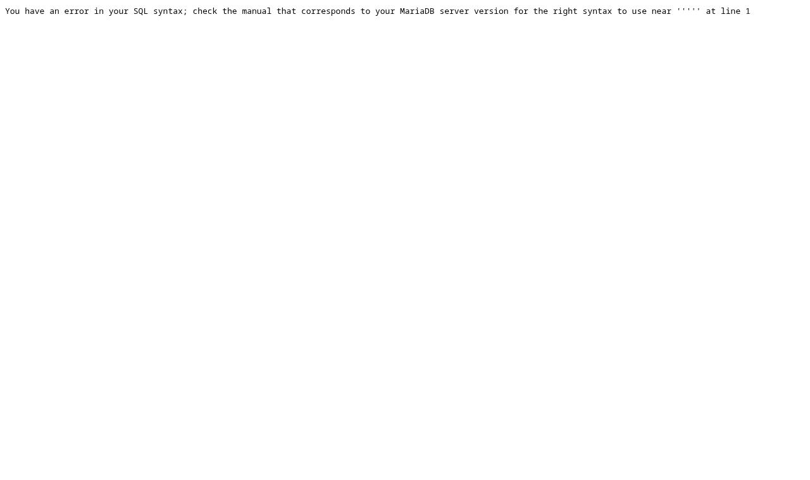
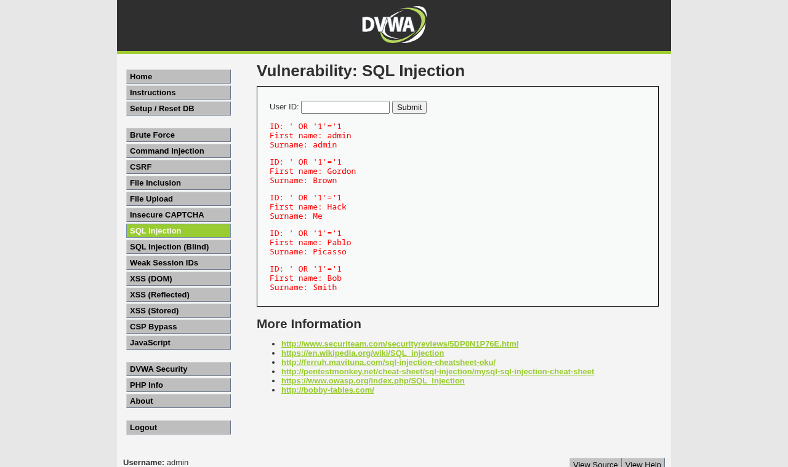
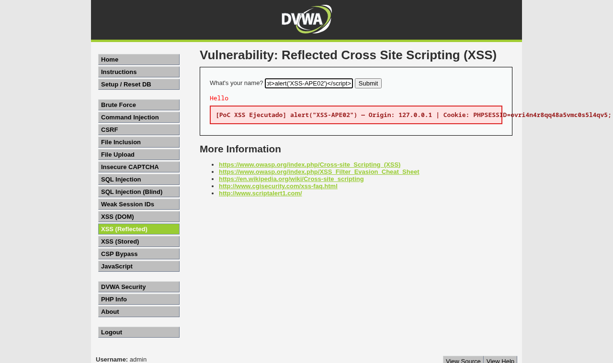
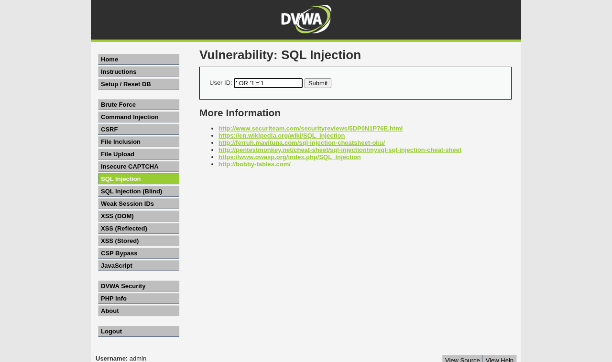
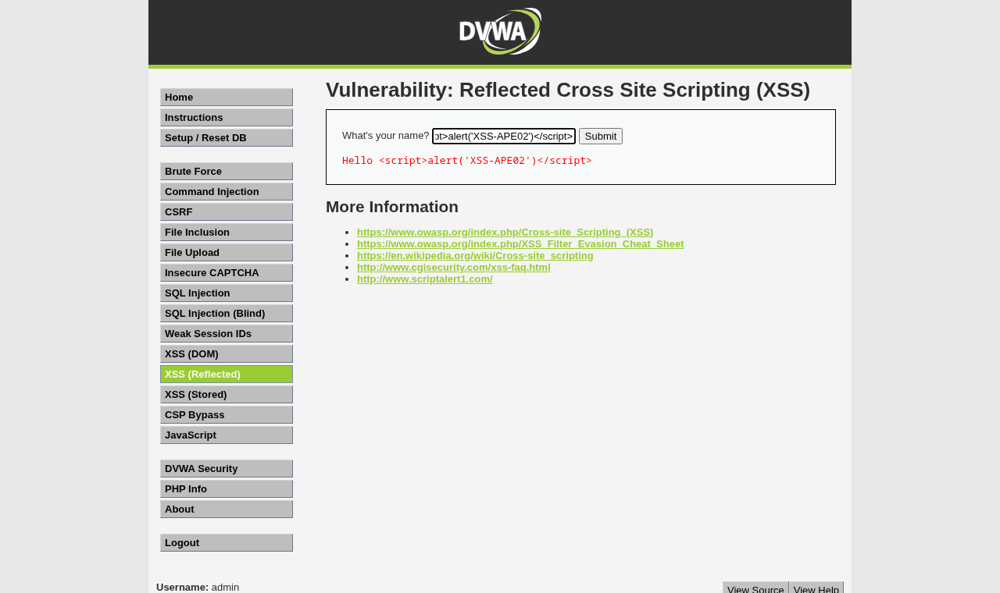
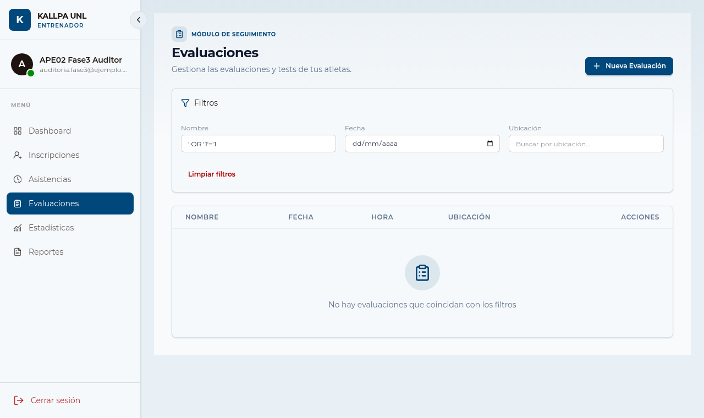
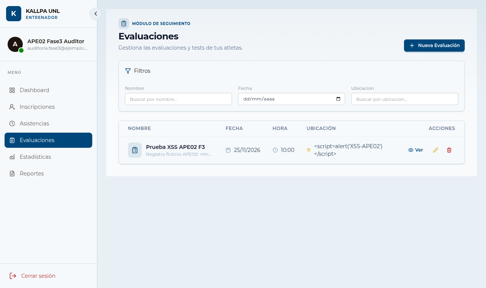
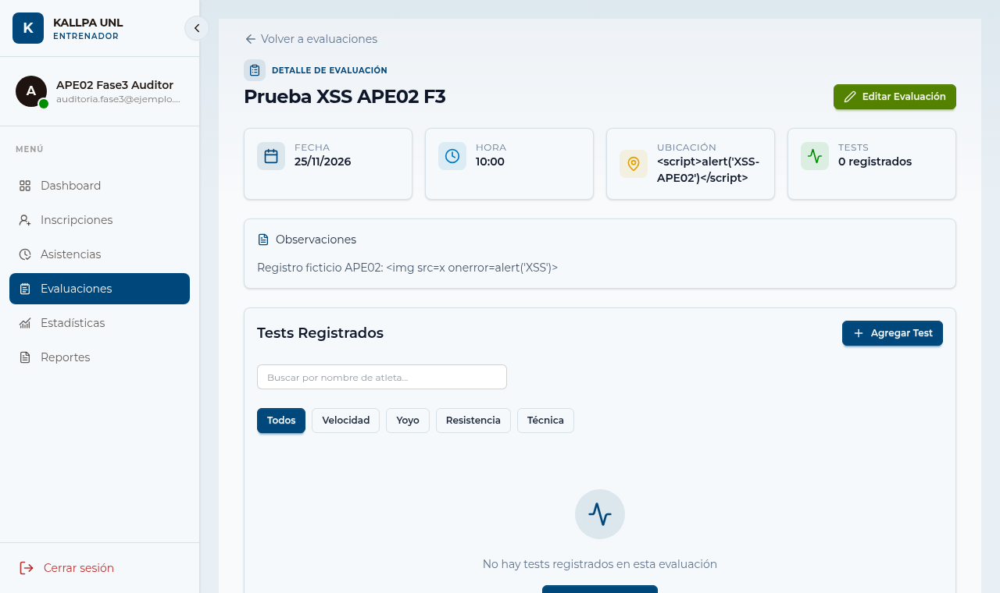

# Documento de pruebas de concepto y mitigación de inyecciones (SQLi y XSS) — Kallpa UNL

**Asignatura:** Software Security · **Guía:** APE 02, Fase 3 (Semana 7) · **Commit revisado:** `e2ceb37`
**Evidencias:** [registro de evidencias](evidencias/registro.md) (I01 a I08) y [salida completa](evidencias/salida-pruebas-inyeccion.txt)

> Cubre la **Sesión 1** (explotación controlada de SQLi y XSS, jueves 19 de noviembre de 2026) y la **Sesión 2** (mitigación, verificación en el proyecto e informe del ciclo hallazgo-mitigación-verificación, viernes 20 de noviembre de 2026).

---

## 1. Causas técnicas de SQLi y XSS (S1-A1)

Los ataques de inyección (categoría **A05:2025 – Injection** en OWASP Top 10) ocurren cuando una aplicación envía datos no confiables a un intérprete (un motor SQL o el motor HTML/JavaScript del navegador) sin separar los **datos** de las **instrucciones ejecutables**.

| Causa técnica | Cómo origina la vulnerabilidad | Relación con la estrategia de mitigación |
|---|---|---|
| **1. Entradas no confiables** | Cualquier parámetro controlado por el usuario (formularios, *query strings* como `?search=`, cabeceras, cuerpo JSON o datos leídos de un servicio externo) puede contener metacaracteres de control (`'`, `--`, `<`, `>`, `"`). Confiar en lo que envía el cliente o validar solo en el navegador deja expuesta a la API. | Exige **validación de entrada en el servidor** mediante listas blancas de tipo, formato y longitud (por ejemplo, esquemas tipados en Pydantic), como primera barrera, aunque nunca como único control. |
| **2. Concatenación de consultas (SQLi)** | Cuando el servidor construye una sentencia SQL uniendo cadenas (por ejemplo, `"SELECT * FROM users WHERE id = '" + id + "'"`), el motor de base de datos compila el comando después de insertar el texto del usuario. Una comilla simple cierra el literal de datos y permite inyectar operadores lógicos (`OR '1'='1`) o nuevas sentencias. | Se corrige con **consultas preparadas o parametrizadas** (o un ORM que use *bind parameters*). El motor compila primero la estructura del `SELECT` y recibe el valor del usuario por separado como dato literal, nunca como código SQL. |
| **3. Falta de escapado de la salida (XSS)** | Cuando la aplicación inserta texto procedente de la petición (*XSS reflejado*) o de la base de datos (*XSS almacenado*) directamente en el HTML sin codificar los caracteres especiales (`<`, `>`, `&`, `"`, `'`), el navegador interpreta ese texto como etiquetas `<script>` o manejadores de eventos (`onerror=`) y los ejecuta en la sesión de la víctima. | Se corrige con **escapado contextual de la salida** (por ejemplo, el escapado automático de nodos de texto en React JSX, `autoescape` en Jinja2 o `htmlspecialchars` en PHP), complementado con la cabecera **`Content-Security-Policy` (CSP)**. |

---

## 2. Laboratorio de explotación controlada en DVWA (S1-A2)

Como Kallpa UNL utiliza SQLAlchemy ORM y React —y por tanto no incluye deliberadamente consultas concatenadas ni renderizado HTML sin escapar—, la guía establece el uso del entorno controlado **DVWA (Damn Vulnerable Web Application v1.10)** para demostrar la explotación de SQLi y XSS reflejado, y luego contrastar el comportamiento frente al proyecto propio. Se levantó un contenedor local aislado en `http://127.0.0.1:4280` configurado en nivel de seguridad **Low**.

### 2.1 Prueba de concepto 1 — SQLi de diagnóstico con comilla simple (`'`)

- **Módulo:** DVWA → *SQL Injection* (`/vulnerabilities/sqli/`).
- **Código vulnerable en el servidor (`low.php`):**
  ```php
  $id = $_REQUEST['id'];
  $query = "SELECT first_name, last_name FROM users WHERE user_id = '$id';";
  $result = mysqli_query($GLOBALS["___mysqli_ston"], $query) or die('<pre>' . mysqli_error(...) . '</pre>');
  ```
- **Payload enviado:** `'`
- **Consulta resultante:** `SELECT first_name, last_name FROM users WHERE user_id = ''';`
- **Resultado observado (evidencia I01):** El motor MariaDB devuelve un error de sintaxis porque quedan tres comillas simples sin emparejar:
  `You have an error in your SQL syntax; check the manual that corresponds to your MariaDB server version for the right syntax to use near ''''' at line 1`.
- **Interpretación:** Confirma que la entrada del usuario se concatena directamente dentro de la sentencia SQL sin parametrizar ni escapar.



### 2.2 Prueba de concepto 2 — SQLi por tautología (`' OR '1'='1`)

- **Módulo:** DVWA → *SQL Injection* (`/vulnerabilities/sqli/`).
- **Payload enviado:** `' OR '1'='1`
- **Consulta resultante:**
  ```sql
  SELECT first_name, last_name FROM users WHERE user_id = '' OR '1'='1';
  ```
- **Resultado observado (evidencia I02):** Al ser `'1'='1'` siempre verdadero, la cláusula `WHERE` se evalúa como `TRUE` para todas las filas de la tabla `users`. La aplicación vuelca los **5 usuarios** registrados en la base (`admin`, `Gordon Brown`, `Hack Me`, `Pablo Picasso` y `Bob Smith`), eludiendo la restricción de consultar un único identificador.



### 2.3 Prueba de concepto 3 — XSS reflejado con script de prueba

- **Módulo:** DVWA → *XSS (Reflected)* (`/vulnerabilities/xss_r/`).
- **Código vulnerable en el servidor (`low.php`):**
  ```php
  header("X-XSS-Protection: 0");
  if (array_key_exists("name", $_GET) && $_GET['name'] != NULL) {
      $html .= '<pre>Hello ' . $_GET['name'] . '</pre>';
  }
  ```
- **Payload enviado:** `<script>alert('XSS-APE02')</script>` (acompañado de un bloque visual de prueba de concepto para dejar constancia en la captura del dominio y de la cookie de sesión accesible desde JavaScript).
- **Resultado observado (evidencia I03):** El servidor concatena la cadena directamente dentro de `<pre>Hello ...</pre>` sin codificar `<` ni `>`. El navegador interpreta la etiqueta `<script>`, dispara el cuadro de diálogo `alert('XSS-APE02')` y tiene lectura completa de `document.cookie` (`PHPSESSID=...`), lo que permitiría secuestrar la sesión.



---

## 3. Sistematización de pruebas de concepto y hallazgos (S1-A3)

Todas las pruebas ejecutadas en la Sesión 1 (sobre DVWA) y en la revisión de Kallpa UNL se sistematizan en la siguiente matriz, vinculada con los archivos de [`evidencias/`](evidencias/registro.md):

| ID PoC | Vector y tipo | Entorno y endpoint | Payload ensayado | Resultado en entorno vulnerable (DVWA Low) | Resultado en Kallpa UNL | Evidencia |
|---|---|---|---|---|---|---|
| **PoC-01** | SQLi — Comilla simple (detección) | DVWA `/vulnerabilities/sqli/` · Kallpa `GET /athletes/all?search=` | `'` | Error SQL expuesto: `syntax to use near '''''` | HTTP 200 con `total: 0` (atletas/evaluaciones) o búsqueda literal sin error SQL | I01, [salida §1.1 y §2.4](evidencias/salida-pruebas-inyeccion.txt) |
| **PoC-02** | SQLi — Tautología en autenticación | Kallpa `POST /api/v1/accounts/login` | `email: "admin@unl.edu.ec' OR '1'='1"`, `password: "' OR '1'='1"` | En un login concatenado autentica sin conocer la clave | **Bloqueado en dos capas:** HTTP 422 por validación de formato de correo; si el correo es válido y la clave es `' OR '1'='1`, devuelve HTTP 401 (`Credenciales inválidas`) porque la clave solo se pasa a `bcrypt.verify()` | [salida §2.1 y §2.2](evidencias/salida-pruebas-inyeccion.txt) |
| **PoC-03** | SQLi — Tautología en filtro de búsqueda | DVWA `/vulnerabilities/sqli/` · Kallpa `GET /athletes/all`, `/users/all`, `/evaluations/` | `' OR '1'='1` | Extrae los 5 registros de la tabla `users` | HTTP 200 con `items: [], total: 0`. SQLAlchemy envía `%(full_name_1)s = "%' OR '1'='1%"` como parámetro enlazado | I02, I07, [salida §2.4 y §2.5](evidencias/salida-pruebas-inyeccion.txt) |
| **PoC-04** | SQLi — Sentencia apilada destructiva | Kallpa `GET /athletes/all?search=` y `/representatives/by-dni/` | `1; DROP TABLE users;--` | Si el driver permite *stacked queries*, ejecuta la segunda sentencia | HTTP 200 (`total: 0`) / HTTP 404 (`Representante no encontrado`). La tabla `users` permanece intacta | [salida §2.4](evidencias/salida-pruebas-inyeccion.txt) |
| **PoC-05** | XSS — Script reflejado / almacenado en interfaz y PDF | DVWA `/vulnerabilities/xss_r/` · Kallpa `POST /evaluations/` (`location`, `observations`) y vista React / Jinja2 | `<script>alert('XSS-APE02')</script>` e `` | Ejecuta JavaScript en el navegador y lee `PHPSESSID` | React renderiza las etiquetas como texto plano en la tabla y en el detalle (`dialogTriggered: false`). Jinja2 las convierte en `&lt;script&gt;...` en el PDF | I03, I06, I08, [salida §2.5](evidencias/salida-pruebas-inyeccion.txt) |

---

## 4. Mitigaciones de referencia (S2-A1)

Antes de verificar y proponer mejoras en el proyecto, se revisaron las tres defensas complementarias contra inyecciones:

| Mitigación | Cómo actúa técnicamente | Estado actual en Kallpa UNL |
|---|---|---|
| **1. Consultas preparadas o parametrizadas** | Separa el código SQL de los parámetros. En PostgreSQL (`psycopg2` / SQLAlchemy), la consulta se envía con marcadores (`WHERE accounts.email = %(email_1)s`) y el valor viaja como dato tipado. Aunque contenga `'` o `OR 1=1`, el motor jamás altera el árbol sintáctico de la consulta. | **Cumple en toda la API:** los 13 DAOs de `BackendFutbol/app/dao/` usan expresiones del ORM de SQLAlchemy (`filter(Model.col == val)`, `.ilike()`), y el microservicio Spring Boot usa `JpaRepository` (`findByIdentification`, `findByEmail`). Solo se halló un `f-string` con nombres de tablas fijas en `scripts/migrate_data.py:125`. |
| **2. Validación de entrada** | Comprueba en el servidor que cada dato cumpla el tipo, longitud y patrón esperados antes de procesarlo (por ejemplo, `int` para IDs, `EmailStr` o regex para correos, `validate_ec_dni` para cédulas). Reduce la superficie de ataque y evita almacenar basura o payloads maliciosos. | **Parcial:** los esquemas de creación de usuarios y atletas validan nombres (`NAME_PATTERN`), DNI y correo, pero los campos libres de evaluaciones (`location`, `observations`) aceptan etiquetas HTML crudas, y el filtro `search` solo se sanea en `UserFilter`, sin escapar los comodines `%` y `_` de `ILIKE` en ningún DAO. |
| **3. Escapado de salida y cabeceras (CSP)** | Codifica los caracteres especiales según el contexto de salida (`<` → `&lt;`, `>` → `&gt;`, `"` → `&quot;`, `'` → `&#39;`) para que el navegador los trate como texto visible y no como código ejecutable. La cabecera `Content-Security-Policy` actúa como segunda línea de defensa bloqueando scripts inline no autorizados. | **Cumple en el escapado; pendiente en cabeceras:** React escapa por defecto todos los nodos JSX (0 usos de `dangerouslySetInnerHTML` o `innerHTML`) y Jinja2 tiene `autoescape=select_autoescape(["html", "xml"])` (`report_service.py:30`). Sin embargo, Nginx no envía `Content-Security-Policy` y pierde sus cabeceras de seguridad en `/` y `/index.html`. |

---

## 5. Evaluación e implementación de mitigaciones en Kallpa UNL (S2-A2)

De acuerdo con el criterio mantenido en las Fases 1 y 2, el código funcional del proyecto no se altera directamente para no romper el entorno compartido; a continuación se documentan los **controles ya implementados en el código** y las **propuestas de código concretas** para cerrar las brechas de defensa en profundidad detectadas.

### 5.1 Consultas parametrizadas en el proyecto y corrección del script de migración

En la API de Kallpa UNL, tanto el login (`account_dao.py:28-35`) como los buscadores (`athlete_dao.py:26-33`, `user_dao.py:49-60`, `evaluation_controller.py:81-91`) ya implementan consultas parametrizadas a través de SQLAlchemy ORM:

```python
# BackendFutbol/app/dao/account_dao.py (líneas 28-35) — YA IMPLEMENTADO
query = (
    db.query(Account)
    .options(joinedload(Account.user))
    .filter(Account.email == email)  # SQLAlchemy enlaza %(email_1)s como parámetro
)
```

Al inspeccionar la compilación real de SQLAlchemy para el dialecto PostgreSQL con el payload `' OR '1'='1` (evidencia en [`salida-pruebas-inyeccion.txt` §2.5](evidencias/salida-pruebas-inyeccion.txt)), se comprueba que la sentencia generada es:

```sql
SELECT accounts.email, accounts.password_hash, accounts.role, accounts.user_id, accounts.id, ...
FROM accounts
WHERE accounts.email = %(email_1)s
-- Parámetros enlazados enviados por separado al motor: {'email_1': "' OR '1'='1"}
```

**Hallazgo puntual en scripts (`F3-05`) y mitigación propuesta:**
En `BackendFutbol/scripts/migrate_data.py:125`, la función `clean_database` construye una sentencia SQL mediante un `f-string`:

```python
# ANTES (BackendFutbol/scripts/migrate_data.py:125) — concatenación con f-string
cur.execute(f"TRUNCATE TABLE {table} RESTART IDENTITY CASCADE;")
```

Aunque `tables` es una lista interna constante, concatenar identificadores con `f-string` es un antipatrón que los analizadores SAST (Bandit `B608`) marcan como riesgo de inyección. Si un identificador proviene de una variable externa, permite inyectar comandos arbitrarios. La mitigación segura en `psycopg2` es usar `psycopg2.sql.Identifier`:

```python
# DESPUÉS (mitigación propuesta con identificadores seguros de psycopg2)
from psycopg2 import sql

ALLOWED_TABLES = frozenset({
    "attendances", "technical_assessments", "yoyo_tests", "sprint_tests",
    "endurance_tests", "tests", "evaluations", "statistics",
    "athletes", "representatives", "accounts", "users",
})

for table in tables:
    if table not in ALLOWED_TABLES:
        raise ValueError(f"Tabla no autorizada: {table}")
    query = sql.SQL("TRUNCATE TABLE {} RESTART IDENTITY CASCADE;").format(
        sql.Identifier(table)
    )
    cur.execute(query)
```

### 5.2 Escapado de comodines en búsquedas `ILIKE` y validación de entrada (`F3-04`)

Al probar el payload `'` contra los cuatro buscadores (`salida-pruebas-inyeccion.txt` §2.4), se observó una diferencia reveladora:

- `GET /athletes/all?search='` devuelve `total: 0` (busca literalmente el carácter `'` en `full_name` o `dni`).
- `GET /users/all?search='` devuelve **`total: 4`** (todas las cuentas activas).

¿Por qué ocurre esto? Porque `UserFilter` (`user_schema.py:253-261`) elimina los caracteres `[;'\"\-]` con `re.sub`, dejando `search = None` cuando se envía `'`, por lo que el DAO no aplica filtro y lista todos los registros. En cambio, si un usuario envía `search=%` o `search=_` en `AthleteFilter`, `EvaluationFilter` o `RepresentativeFilter`, esos caracteres actúan como **comodines de PostgreSQL en `ILIKE`**, permitiendo enumerar todos los registros o hacer búsquedas por longitud aunque el usuario no conozca ningún nombre.

**Mitigación propuesta (escapar comodines `ILIKE` y rechazar etiquetas HTML en campos de texto libre):**

```python
# app/utils/sql_helpers.py (nuevo auxiliar para todos los DAOs con ILIKE)
def escape_ilike(term: str) -> str:
    """Escapa los comodines %, _ y la barra inversa para búsquedas literales con ILIKE."""
    cleaned = term.strip()
    escaped = cleaned.replace("\\", "\\\\").replace("%", "\\%").replace("_", "\\_")
    return f"%{escaped}%"

# Uso en AthleteDAO, UserDAO, RepresentativeDAO y EvaluationController:
pattern = escape_ilike(filters.search)
query = query.filter(
    or_(
        self.model.full_name.ilike(pattern, escape="\\"),
        self.model.dni.ilike(pattern, escape="\\"),
    )
)
```

Asimismo, para evitar que se almacenen payloads HTML/XSS en la base de datos (como ocurrió al crear la evaluación `id=4` con `location: "<script>alert('XSS-APE02')</script>"`), se propone validar y rechazar caracteres de etiquetas HTML (`<`, `>`) en los esquemas de entrada `CreateEvaluationSchema` y `UpdateEvaluationSchema`:

```python
# BackendFutbol/app/schemas/evaluation_schema.py
import re

HTML_TAG_RE = re.compile(r"[<>]")

@field_validator("name", "location", "observations")
@classmethod
def reject_html_tags(cls, v: Optional[str]) -> Optional[str]:
    if v is not None and HTML_TAG_RE.search(v):
        raise ValueError("El campo no puede contener etiquetas HTML (< o >)")
    return v.strip() if v else v
```

### 5.3 Escapado de salida (React y Jinja2) y endurecimiento de cabeceras Nginx (`F3-02`, `F3-03`)

El escapado de salida está implementado en las dos vistas que renderizan datos del sistema:

1. **Interfaz web (React 19):** En `EvaluationsList.jsx:274,278,308` y `EvaluationDetail.jsx:294,361,397`, los campos se interpolan con llaves `{evaluation.name}`, `{evaluation.location}` y `{evaluation.observations}`. React codifica automáticamente los nodos de texto en el DOM antes de pintarlos, sin usar `dangerouslySetInnerHTML`.
2. **Generador de reportes PDF (Jinja2 + WeasyPrint):** En `BackendFutbol/app/services/report_service.py:28-31`, el entorno de plantillas activa explícitamente el autoescapado para HTML y XML:
   ```python
   # BackendFutbol/app/services/report_service.py (líneas 28-31) — YA IMPLEMENTADO
   self.env = Environment(
       loader=FileSystemLoader("app/templates"),
       autoescape=select_autoescape(["html", "xml"]),
   )
   ```

**Brecha de defensa en profundidad (`F3-03`) y mitigación propuesta en Nginx:**
Como se comprobó en la sección 2.6 de [`salida-pruebas-inyeccion.txt`](evidencias/salida-pruebas-inyeccion.txt), una petición a `http://localhost:5173/` devuelve únicamente `Cache-Control`, sin `Content-Security-Policy`, `X-Content-Type-Options` ni `X-Frame-Options`. Esto ocurre porque `FrontendFutbol/nginx.conf` declara `add_header` en el bloque `server`, pero los bloques `location = /index.html` y `location ~* \.(js|css|...)$` definen su propio `add_header Cache-Control`, lo que en Nginx anula todas las cabeceras del nivel superior.

Para que el navegador aplique una política **Content-Security-Policy (CSP)** que bloquee cualquier script inline (`<script>...</script>` o `onerror=...`) incluso si en el futuro alguien introdujera un componente inseguro, se propone corregir `FrontendFutbol/nginx.conf`:

```nginx
# FrontendFutbol/nginx.conf — Mitigación propuesta (CSP + herencia corregida)
server {
    listen 80;
    server_name localhost;
    root /usr/share/nginx/html;
    index index.html;

    # Variable o bloque común de cabeceras de seguridad contra XSS y clickjacking
    set $csp_policy "default-src 'self'; script-src 'self'; style-src 'self' 'unsafe-inline'; img-src 'self' data: blob:; font-src 'self' data:; connect-src 'self' http://localhost:8001; object-src 'none'; base-uri 'self'; frame-ancestors 'none'";

    location / {
        try_files $uri $uri/ /index.html;
        add_header Content-Security-Policy $csp_policy always;
        add_header X-Frame-Options "DENY" always;
        add_header X-Content-Type-Options "nosniff" always;
        add_header Referrer-Policy "strict-origin-when-cross-origin" always;
    }

    location = /index.html {
        expires -1;
        add_header Cache-Control "no-store, no-cache, must-revalidate" always;
        add_header Content-Security-Policy $csp_policy always;
        add_header X-Frame-Options "DENY" always;
        add_header X-Content-Type-Options "nosniff" always;
        add_header Referrer-Policy "strict-origin-when-cross-origin" always;
    }

    location ~* \.(js|css|png|jpg|jpeg|gif|ico|svg|woff|woff2|ttf|eot)$ {
        expires 1y;
        add_header Cache-Control "public, immutable" always;
        add_header X-Content-Type-Options "nosniff" always;
    }
}
```

---

## 6. Re-ejecución de payloads y verificación de las mitigaciones (S2-A2)

Se re-ejecutaron exactamente los mismos payloads de la Sesión 1 tanto en **DVWA con la mitigación activada (nivel *Impossible*)** como en **Kallpa UNL**, utilizando el script reproducible [`pruebas-inyeccion.sh`](evidencias/pruebas-inyeccion.sh).

### 6.1 Verificación en DVWA (nivel *Impossible*: PDO parametrizado y `htmlspecialchars`)

En el nivel *Impossible*, DVWA reemplaza la concatenación por consultas preparadas con PDO (`$db->prepare('SELECT first_name, last_name FROM users WHERE user_id = (:id) LIMIT 1;'); $data->bindParam(':id', $id, PDO::PARAM_INT);`) junto con validación `is_numeric($id)`, y envuelve la salida de XSS con `htmlspecialchars($_GET['name'])`.

- **Re-ejecución de SQLi (`' OR '1'='1`) — evidencia I04:** La consulta es rechazada y devuelve **0 registros**, sin errores de sintaxis ni exposición de cuentas.
- **Re-ejecución de XSS (`<script>alert('XSS-APE02')</script>`) — evidencia I05:** El servidor devuelve `Hello &lt;script&gt;alert('XSS-APE02')&lt;/script&gt;`. El navegador muestra el texto literal en pantalla sin ejecutar ningún script.





### 6.2 Verificación en Kallpa UNL (SQLAlchemy ORM, React JSX y Jinja2 `autoescape`)

1. **Verificación frente a SQLi en login y buscadores (evidencia I07):**
   - En `POST /api/v1/accounts/login`, el payload `{"email": "admin@unl.edu.ec' OR '1'='1", "password": "' OR '1'='1"}` es bloqueado con **HTTP 422** por el validador de correo. Al enviar un correo válido con la contraseña `' OR '1'='1`, responde **HTTP 401 (`Credenciales inválidas`)**.
   - En el buscador de evaluaciones y de atletas (`GET /api/v1/evaluations/?search=' OR '1'='1` y en la interfaz web), SQLAlchemy parametriza la cadena dentro de `ILIKE %(name_1)s` y la interfaz muestra *«No hay evaluaciones que coincidan con los filtros»* (`total: 0`), sin filtrar datos ajenos.



2. **Verificación frente a XSS en la interfaz React y en reportes PDF (evidencias I06 e I08):**
   - Se insertó mediante `POST /api/v1/evaluations/` una evaluación ficticia con `location: "<script>alert('XSS-APE02')</script>"` y `observations: "Registro ficticio APE02: "`.
   - Al abrir la tabla de evaluaciones (`/seguimiento/evaluations`, evidencia **I06**) y la vista de detalle (`/seguimiento/evaluations/4`, evidencia **I08**) en el navegador Brave, **no se disparó ningún diálogo ni evento `onerror`** (`dialogTriggered: false`): React escapó ambos vectores y los mostró como texto plano dentro de las tarjetas.
   - Al renderizar los mismos payloads con el motor Jinja2 de `ReportService` (`salida-pruebas-inyeccion.txt` §2.5), la salida producida fue:
     `<td>&lt;script&gt;alert(&#39;XSS-APE02&#39;)&lt;/script&gt;</td> | <strong>Generado por:</strong> Entrenador &lt;img src=x onerror=alert(1)&gt;`, confirmando que WeasyPrint recibe entidades HTML inofensivas.





---

## 7. Ciclo hallazgo-mitigación-verificación (S2-A3)

| ID | Hallazgo / Control evaluado | Riesgo | Mitigación (implementada o propuesta) | Verificación frente a los payloads ensayados |
|---|---|---|---|---|
| **F3-01** | **Prevención de SQLi en la API y microservicio:** todas las consultas de autenticación y filtrado usan SQLAlchemy ORM (`BackendFutbol/app/dao/*.py`) y Spring Data JPA (`PersonRepository`, `AccountRepository`). | Control positivo | **Implementada:** uso de expresiones ORM con parámetros enlazados (`%(param)s`) y validación de esquemas en Pydantic (`LoginRequest`, `AthleteFilter`, `UserFilter`). | Se probaron `'`, `' OR '1'='1`, `100%'` y `1; DROP TABLE users;--` en login y en 4 endpoints de búsqueda (`I07`, `salida §2.1–2.5`). Todos los ataques fueron neutralizados (HTTP 422/401 en login; 0 registros filtrados en búsquedas). |
| **F3-02** | **Prevención de XSS en React y en reportes PDF:** el frontend renderiza variables mediante JSX sin `dangerouslySetInnerHTML`, y el backend configura `select_autoescape(["html", "xml"])` en Jinja2 (`report_service.py:30`). | Control positivo | **Implementada:** escapado contextual automático de salida en el DOM de React y en las plantillas HTML de WeasyPrint (`report_base.html`). | Se inyectaron `<script>alert('XSS-APE02')</script>` e `` en una evaluación (`I06`, `I08`, `salida §2.5`). En React se visualizaron como texto literal sin ejecución de scripts y en Jinja2 se codificaron como `&lt;script&gt;` y `&#39;`. |
| **F3-03** | **Falta de CSP y pérdida de cabeceras de seguridad en Nginx:** `FrontendFutbol/nginx.conf` no define `Content-Security-Policy` y los bloques `location` con `add_header Cache-Control` anulan `X-Frame-Options` y `X-Content-Type-Options` (relacionado con `F1-06` y `F2-03`). | **Media** | **Propuesta documentada (§5.3):** incluir `Content-Security-Policy` (`script-src 'self'; object-src 'none'`), `X-Frame-Options: DENY` y `X-Content-Type-Options: nosniff` dentro de cada bloque `location` de `nginx.conf`. | Se verificó con `curl -I http://localhost:5173/` (`salida §2.6`) la ausencia actual de las cabeceras en la respuesta de `/`. Con la directiva `script-src 'self'`, el navegador bloquea cualquier script inline incluso si fallara el escapado de una vista. |
| **F3-04** | **Sanitización de entrada inconsistente, comodines `ILIKE` sin escapar y almacenamiento de HTML crudo:** `UserFilter` borra `[;'\"\-]`, los demás filtros no escapan `%` ni `_` en `ILIKE`, y `Evaluation` guarda etiquetas `<script>` en la base de datos. | **Baja** | **Propuesta documentada (§5.2):** función `escape_ilike()` con `escape="\\"` en todos los DAOs y validador `reject_html_tags` en los esquemas Pydantic de texto libre. | Se demostró que `GET /users/all?search='` devuelve los 4 usuarios porque el regex vacía el filtro, mientras que `POST /evaluations/` acepta y persiste `<script>` en PostgreSQL (`salida §2.4`). Aunque el escapado de salida evita hoy el XSS, rechazar etiquetas en la entrada impide almacenar payloads latentes. |
| **F3-05** | **Concatenación con `f-string` en script de migración:** `scripts/migrate_data.py:125` ejecuta `cur.execute(f"TRUNCATE TABLE {table} RESTART IDENTITY CASCADE;")`. | **Baja** | **Propuesta documentada (§5.1):** validar contra una lista blanca `ALLOWED_TABLES` y usar `psycopg2.sql.SQL(...).format(sql.Identifier(table))`. | Verificado por inspección estática del código (`migrate_data.py:108-129`). La lista actual es fija y el script no está expuesto a la API, pero parametrizar el identificador elimina el antipatrón de concatenación SQL. |

---

## 8. Pregunta de control N.º 3

> Las consultas preparadas mitigan la inyección SQL y el escapado de salida mitiga el XSS. ¿Por qué la validación de entrada por sí sola no basta para prevenir ambos tipos de ataque? Explique su respuesta con un ejemplo aplicado a su propio proyecto.

La **validación de entrada** comprueba que un dato cumpla ciertas reglas sintácticas o de negocio (longitud, tipo o caracteres permitidos) en el momento en que ingresa al sistema, pero **no conoce ni controla cómo interpretará ese dato cada motor aguas abajo** (PostgreSQL, el navegador web o un generador de PDF). Por tres razones fundamentales no basta por sí sola:

1. **Los caracteres legítimos del dominio pueden ser metacaracteres en el intérprete de destino:** En una aplicación real no siempre es posible prohibir comillas, signos o símbolos sin dañar datos válidos. Por ejemplo, un apellido como `O'Connor` contiene una comilla simple `'`, o una observación deportiva en **Kallpa UNL** como `"Tiempo < 4.5s en 0-30m & ritmo > 80%"` utiliza legítimamente `<`, `>` y `&`. Si la única defensa fuera concatenar en SQL o insertar en HTML confiando en la validación, `O'Connor` rompería la consulta SQL y `< 4.5s` alteraría el árbol HTML.
2. **Las listas negras con expresiones regulares son frágiles e incompletas:** En nuestro propio proyecto lo comprobamos en `UserFilter` (`BackendFutbol/app/schemas/user_schema.py:259-260`), donde el desarrollador intentó prevenir SQLi con `re.sub(r"[;'\"\-]", "", v)`. Ese filtro de entrada provoca un efecto colateral inesperado: cuando se busca `GET /api/v1/users/all?search='` (evidencia en `salida-pruebas-inyeccion.txt` §2.4), el validador borra la comilla, deja el filtro vacío y **devuelve todos los usuarios del sistema**. Además, ese mismo filtro no impide enviar comodines como `%` o `_` a `ILIKE`, ni evita otros vectores si la consulta subyacente no estuviera parametrizada.
3. **Los datos pueden provenir de fuentes secundarias o cambiar de contexto (*second-order injection*):** En **Kallpa UNL**, los nombres y direcciones de deportistas y representantes también se sincronizan desde el microservicio externo de personas en Spring Boot/MariaDB (`person_ms_service.py`) y luego se reutilizan en dos contextos distintos: la interfaz React y los reportes PDF generados con Jinja2 y WeasyPrint (`report_service.py`). Aunque un campo pasara una validación básica al registrarse, si `ReportService` no tuviera activado `autoescape=select_autoescape(["html", "xml"])` al construir `report_base.html`, cualquier cadena con `<script>` o `` almacenada previamente en PostgreSQL o en MariaDB se inyectaría sin control dentro del HTML que procesa WeasyPrint.

En conclusión, la validación de entrada es una excelente **capa de higiene y defensa en profundidad**, pero la mitigación definitiva exige actuar en la frontera exacta de cada intérprete: **consultas parametrizadas** al hablar con la base de datos (para que el dato jamás sea código SQL) y **escapado contextual de la salida** al renderizar en React o Jinja2 (para que el dato jamás sea código HTML/JavaScript).

---

## 9. Consolidación y enlace al repositorio

El documento de pruebas de concepto, el script reproducible y las ocho capturas de explotación y verificación (I01 a I08) quedan registrados en `Auditoria-Seguridad/APE-02/Fase-03/`.

**Repositorio:** https://github.com/Axlmd16/Sgt_Kallpa/tree/master/Auditoria-Seguridad/APE-02/Fase-03

Los datos ficticios utilizados durante la verificación en Kallpa UNL y el contenedor temporal de DVWA fueron eliminados al finalizar la sesión conforme al procedimiento de [registro.md](evidencias/registro.md).
