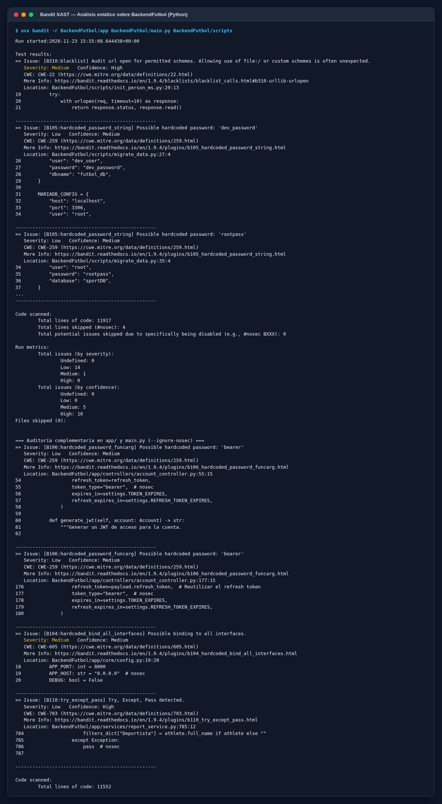
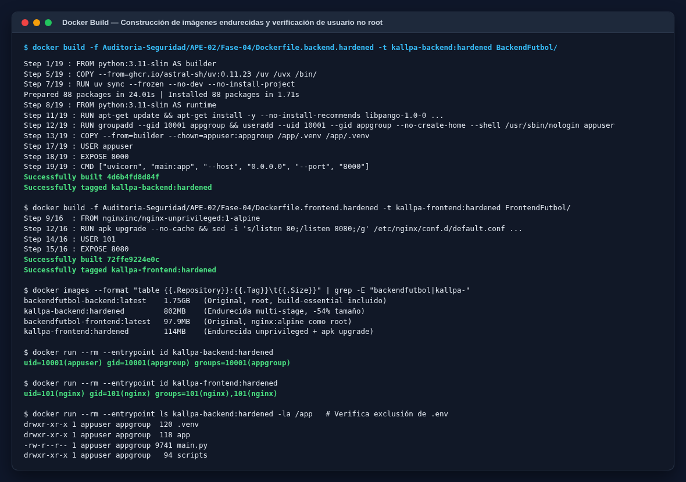
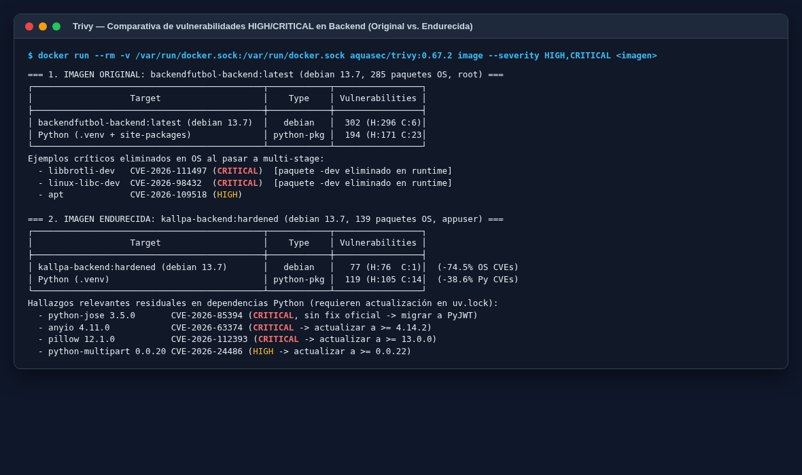
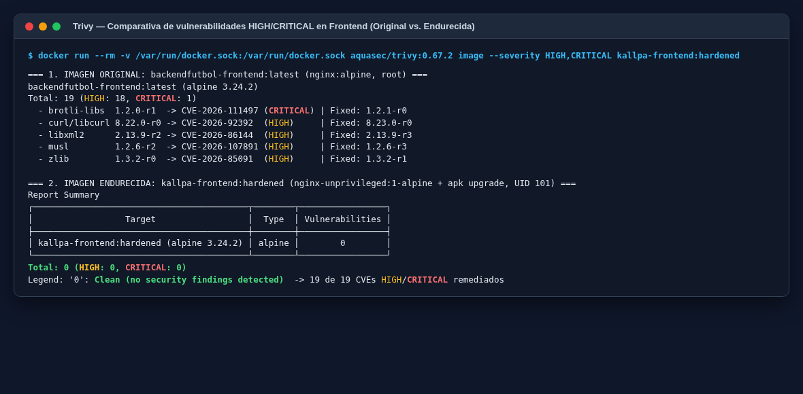

# Fase 4 — Análisis estático (SAST) y endurecimiento en contenedores Docker

**Proyecto:** Kallpa UNL · **Asignatura:** Software Security · **Semana 8** (26 y 27 de noviembre de 2026) · **Commit revisado:** `a3bb556`
**Dockerfiles endurecidos:** [Dockerfile.backend.hardened](Dockerfile.backend.hardened) · [Dockerfile.frontend.hardened](Dockerfile.frontend.hardened)
**Evidencias y reportes completos:** [registro de evidencias](evidencias/registro.md) · [salida Bandit](evidencias/salida-bandit.txt) · [salida Bandit `--ignore-nosec`](evidencias/salida-bandit-app-sin-nosec.txt) · [Trivy Backend (original vs. endurecida)](evidencias/salida-trivy-backend-hardened.txt) · [Trivy Frontend (endurecida)](evidencias/salida-trivy-frontend-hardened.txt)

| Actividad de la guía | Sección | Estado |
|---|---|---|
| S1-A1 Repaso del análisis estático (SAST) | [§1. Análisis estático (SAST): alcance y limitaciones](#1-análisis-estático-sast-alcance-y-limitaciones-s1-a1) | Completado |
| S1-A2 Ejecución del analizador estático (Bandit) | [§2. Ejecución de Bandit sobre BackendFutbol](#2-sesión-1--ejecución-de-bandit-sast-e-interpretación-s1-a2-y-s1-a3) — captura S01 | Completado |
| S1-A3 Priorización de acciones correctivas | [§2.2 Tabla de hallazgos SAST y acciones correctivas priorizadas](#22-tabla-de-hallazgos-sast-y-acciones-correctivas-priorizadas) | Completado |
| S2-A1 Buenas prácticas de contenedores | [§3.1 Buenas prácticas aplicadas](#31-buenas-prácticas-aplicadas-en-los-dockerfiles-endurecidos) | Completado |
| S2-A2 Construcción de imagen endurecida y escaneo Trivy | [§3. Sesión 2 — Endurecimiento de contenedores y escaneo Trivy](#3-sesión-2--endurecimiento-de-contenedores-dockerfile-y-escaneo-con-trivy-s2-a1-y-s2-a2) — capturas S02, S03, S04 | Completado |
| S2-A3 Consolidación del portafolio de la Unidad 1 | [§4. Pregunta de control N.º 4](#4-pregunta-de-control-nº-4) y [§5. Cierre del informe — Portafolio de la Unidad 1](#5-cierre-de-informe--portafolio-consolidado-de-la-unidad-1-s2-a3) | Completado |

---

## 1. Análisis estático (SAST): alcance y limitaciones (S1-A1)

El **análisis estático de seguridad de aplicaciones (SAST)** examina el código fuente sin ejecutar el programa, construyendo el árbol sintáctico abstracto (AST) para identificar patrones inseguros de forma temprana en el ciclo de desarrollo (IDE, *pre-commit* o *pull requests* en GitHub Actions).

- **Qué detecta:** credenciales embebidas en el código (`B105`/`B106`), funciones peligrosas (`eval`, `exec`, `pickle`, `urlopen` sin validar esquema `B310`), generación pseudoaleatoria débil (`B311`), concatenaciones SQL (`B608`), manejo silencioso de excepciones (`B110`) y enlaces de red amplios (`B104`).
- **Sus limitaciones:** no ve la configuración efectiva del entorno en ejecución (puertos expuestos, cabeceras Nginx reales, HTTPS), no descubre fallos de lógica de negocio o autorización como el **IDOR** demostrado en la Fase 2, y puede producir **falsos positivos** (como marcar `token_type="bearer"` como contraseña fija) o **falsos negativos** cuando se desactivan reglas con `# nosec` sin revisión.

---

## 2. Sesión 1 — Ejecución de Bandit (SAST) e interpretación (S1-A2 y S1-A3)

Se ejecutó **Bandit v1.9.4** (analizador SAST oficial de PyCQA para Python) sobre el código de `BackendFutbol/` en dos pasadas complementarias:

1. **Escaneo completo incluyendo scripts operativos:**
   ```bash
   uvx bandit -r BackendFutbol/app BackendFutbol/main.py BackendFutbol/scripts -f txt
   ```
   - **Código analizado:** 11 917 líneas de código en 0 archivos omitidos.
   - **Resultado:** **15 hallazgos** (**0 High**, **1 Medium**, **14 Low**) y **4 líneas omitidas con `# nosec`** (además, `pyproject.toml:60-61` excluye `scripts` por defecto en `[tool.bandit]`, ocultando estos hallazgos en ejecuciones rutinarias).
2. **Auditoría de los `# nosec` en `app/` y `main.py` (`--ignore-nosec`):**
   ```bash
   uvx bandit -r BackendFutbol/app BackendFutbol/main.py --ignore-nosec -f txt
   ```
   - Reveló los **4 hallazgos suprimidos** (1 Medium y 3 Low) para evaluar si cada `# nosec` está realmente justificado.

### 2.1 Captura de la ejecución de Bandit (Evidencia S01)



### 2.2 Tabla de hallazgos SAST y acciones correctivas priorizadas

| Prioridad | Regla / CWE | Severidad (Confianza) | Ubicación (`archivo:línea`) | Interpretación del hallazgo | Acción correctiva / Remediación propuesta |
|---|---|---|---|---|---|
| **1 (Alta)** | `B105` · CWE-259 (`hardcoded_password_string`) | Low (Medium) → **Riesgo efectivo: Alto** | `BackendFutbol/scripts/migrate_data.py:27, 35, 175-177` | Credenciales fijas en texto claro (`dev_password`, `rootpass`, `admin123`, `coach123`, `intern123`) dentro del script de migración, ocultas por `exclude_dirs = ["scripts"]` en `pyproject.toml`. | Leer `POSTGRES_PASSWORD` y `MARIADB_PASSWORD` desde `os.environ` (sin valores por defecto), generar contraseñas iniciales seguras con `secrets` y retirar `"scripts"` de `exclude_dirs` en `pyproject.toml`. |
| **2 (Media)** | `B310` · CWE-22 (`urllib_urlopen`) | **Medium** (High) | `BackendFutbol/scripts/init_person_ms.py:20` | `urlopen(req, timeout=10)` abre una URL construida con `PERSON_MS_BASE_URL` sin validar que el esquema sea exclusivamente `http://` o `https://`, permitiendo teóricamente esquemas `file://`. | Validar con `urllib.parse.urlparse(BASE_URL).scheme in ("http", "https")` antes de la petición, o migrar a `httpx.Client` (ya presente en las dependencias del backend). |
| **3 (Media)** | `B104` · CWE-605 (`hardcoded_bind_all_interfaces`) | **Medium** (Medium) · *Suprimido con `# nosec`* | `BackendFutbol/app/core/config.py:19` | `APP_HOST: str = "0.0.0.0"` enlaza Uvicorn a todas las interfaces de red. Es necesario dentro del contenedor Docker para aceptar tráfico del proxy, pero riesgoso si se ejecuta en local sin contenedor. | Mantener `# nosec B104` documentado **solo** para despliegue en contenedor, cambiar el valor por defecto a `127.0.0.1` en desarrollo local y restringir la publicación en `docker-compose.yml` a `127.0.0.1:8001:8000`. |
| **4 (Baja)** | `B110` · CWE-703 (`try_except_pass`) | Low (High) · *Suprimido con `# nosec`* | `BackendFutbol/app/services/report_service.py:785-786` | `except Exception: pass` silencia cualquier fallo al consultar el nombre del atleta para los metadatos del reporte, dificultando la detección de errores o fallos de integridad. | Reemplazar `pass` por `logger.warning("No se pudo cargar atleta %s para metadata: %s", filters.athlete_id, exc)` y capturar excepciones concretas (`SQLAlchemyError`). |
| **5 (Baja)** | `B311` · CWE-330 (`random`) | Low (High) | `BackendFutbol/scripts/migrate_data.py:60, 66, 252, 273-275, 324-326` | Uso del módulo `random` (no criptográfico) en 7 líneas para generar fechas de nacimiento, estaturas y pesos ficticios de prueba. | **Falso positivo operativo (aceptado):** no se usa para tokens ni contraseñas (el mismo archivo ya usa `secrets.choice` en la línea 55). Documentar con `# nosec B311` justificado. |
| **6 (Info)** | `B106` · CWE-259 (`hardcoded_password_funcarg`) | Low (Medium) · *Suprimido con `# nosec`* | `BackendFutbol/app/controllers/account_controller.py:55, 177` | Marca `token_type="bearer"` porque el nombre del argumento contiene `token`. | **Falso positivo confirmado:** `"bearer"` es el esquema estándar OAuth 2.0 (RFC 6750), no un secreto. Se recomienda precisar la supresión como `# nosec B106`. |

---

## 3. Sesión 2 — Endurecimiento de contenedores (`Dockerfile`) y escaneo con Trivy (S2-A1 y S2-A2)

### 3.1 Buenas prácticas aplicadas en los Dockerfiles endurecidos

Al revisar los Dockerfiles originales del proyecto (`BackendFutbol/Dockerfile` y `FrontendFutbol/Dockerfile`), se detectaron tres debilidades clave: ambos ejecutaban los procesos como **`root`**, el backend usaba una sola etapa con `build-essential`, `gcc` y `uv:latest` en la imagen final (1.75 GB), y el frontend usaba la etiqueta genérica `nginx:alpine` sin parches recientes.

Se escribieron y construyeron dos Dockerfiles endurecidos —[Dockerfile.backend.hardened](Dockerfile.backend.hardened) y [Dockerfile.frontend.hardened](Dockerfile.frontend.hardened)— aplicando las **3 buenas prácticas obligatorias**:

| Práctica obligatoria | Estado original | Endurecimiento aplicado |
|---|---|---|
| **1. Imagen base mínima y versión fija** (nunca `:latest`) | Backend: `python:3.11-slim` + `ghcr.io/astral-sh/uv:latest` en una sola etapa con compiladores (`build-essential`, `python3-dev`, `libcairo2-dev`). Frontend: `nginx:alpine`. | Backend: **multi-stage** con `python:3.11-slim` y `ghcr.io/astral-sh/uv:0.11.23` (versión fija); la etapa `runtime` elimina `build-essential` y paquetes `-dev`, bajando de **1.75 GB a 802 MB (-54 %)** y de **285 a 139 paquetes OS**. Frontend: `node:20-alpine` (build) → `nginxinc/nginx-unprivileged:1-alpine` + `apk upgrade --no-cache`. |
| **2. Usuario sin privilegios** (`USER`, prohibido `root`) | Ambos contenedores arrancaban como `uid=0(root)`. | Backend: `groupadd --gid 10001 appgroup && useradd --uid 10001 ... --shell /usr/sbin/nologin appuser` y **`USER appuser`** (`uid=10001`). Frontend: **`USER 101`** (`uid=101(nginx)`), puerto no privilegiado `8080`. |
| **3. Exposición mínima de puertos (`EXPOSE`) y exclusión de `.env`** | Backend: `COPY . .` (dependiendo solo de `.dockerignore`). Frontend: `EXPOSE 80` (puerto privilegiado). | Backend: copia selectiva (`main.py`, `app/`, `scripts/`) + verificación de `.dockerignore` (excluye `.env`, `.env.local`, `.git`, `tests`, `*.log`) y **`EXPOSE 8000`**. Frontend: **`EXPOSE 8080`** y `.dockerignore` excluyendo `.env` y `.env.local`. |

### 3.2 Captura de la construcción (`docker build`) y verificación de usuario no root (Evidencia S02)

```bash
docker build -f Auditoria-Seguridad/APE-02/Fase-04/Dockerfile.backend.hardened  -t kallpa-backend:hardened  BackendFutbol/
docker build -f Auditoria-Seguridad/APE-02/Fase-04/Dockerfile.frontend.hardened -t kallpa-frontend:hardened FrontendFutbol/
```



### 3.3 Escaneo de vulnerabilidades con Trivy (Original vs. Endurecida)

Se escanearon las imágenes originales y las endurecidas con **Trivy v0.67.2** (`--severity HIGH,CRITICAL --scanners vuln`).

| Imagen | Usuario en ejecución | Tamaño | Paquetes OS | CVEs OS (`HIGH`/`CRITICAL`) | CVEs Python (`HIGH`/`CRITICAL`) | Reducción lograda |
|---|---|---:|---:|---:|---:|---|
| `backendfutbol-backend:latest` *(Original)* | `root` (UID 0) | 1.75 GB | 285 | **302** (296 H / 6 C) | **194** (171 H / 23 C) | Línea base |
| `kallpa-backend:hardened` *(Endurecida)* | `appuser` (UID 10001) | **802 MB** | **139** | **77** (76 H / 1 C) | **119** (105 H / 14 C) | **-74.5 % CVEs de OS** (-225) · **-54 % tamaño** |
| `backendfutbol-frontend:latest` *(Original)* | `root` (UID 0) | 97.9 MB | 71 | **19** (18 H / 1 C) | — | Línea base |
| `kallpa-frontend:hardened` *(Endurecida)* | `nginx` (UID 101) | 114 MB | 71 | **0** (0 H / 0 C) | — | **-100 % CVEs** (19/19 remediados, *Clean*) |





### 3.4 Corrección y justificación documentada de hallazgos relevantes del escaneo

1. **Hallazgo corregido #1 — `CVE-2026-111497` (`CRITICAL`) en `brotli-libs` y `libbrotli-dev` (Frontend y Backend):**
   - **Descripción:** Escritura fuera de límites (*Out-of-Bounds Write*) en el decodificador Brotli (`brotli-libs 1.2.0-r1` en Alpine y `libbrotli-dev 1.1.0-2+b7` en Debian).
   - **Corrección aplicada y verificada:** En `Dockerfile.frontend.hardened` se añadió `apk upgrade --no-cache` actualizando `brotli-libs` a `1.2.1-r0` (junto con `curl`, `libxml2`, `musl` y `zlib`), reduciendo las vulnerabilidades HIGH/CRITICAL del frontend de **19 a 0**. En `Dockerfile.backend.hardened`, la separación *multi-stage* eliminó por completo `libbrotli-dev` y `linux-libc-dev` (`CVE-2026-98432`, CRITICAL) de la imagen de producción, eliminando 5 de los 6 CVEs críticos del sistema operativo.
2. **Hallazgo justificado / planificado #2 — `CVE-2026-85394` (`CRITICAL`) en `python-jose 3.5.0` (Backend):**
   - **Descripción:** Vulnerabilidad de confusión de algoritmo en `python-jose <= 3.5.0` (sin versión corregida publicada en PyPI; `status: affected`).
   - **Justificación temporal y remediación planificada:** En Kallpa UNL el riesgo inmediato está mitigado en código porque `BackendFutbol/app/utils/security.py:195-198` fija explícitamente `algorithms=[settings.JWT_ALGORITHM]` (`HS256`) y no acepta el algoritmo declarado por la cabecera del token (verificado en Fase 2). Como no existe parche oficial en `python-jose` y modificar `uv.lock` queda fuera del alcance de esta auditoría documental, se documenta la migración definitiva de `python-jose` a **`PyJWT`** y la actualización de `anyio >= 4.14.2`, `pillow >= 13.0.0` y `python-multipart >= 0.0.22` en el siguiente sprint de mantenimiento.

---

## 4. Pregunta de control N.º 4

> ¿Qué clases de vulnerabilidades detecta el análisis estático (SAST) que el análisis dinámico (DAST) no, y viceversa? ¿Qué aporta el escaneo de la imagen Docker al ciclo de entrega segura del proyecto?

- **Qué detecta SAST que DAST no ve:** SAST inspecciona el 100 % del código fuente, incluidas **ramas muertas, scripts administrativos y rutas no expuestas por HTTP**. En Kallpa UNL, Bandit detectó las contraseñas quemadas en `scripts/migrate_data.py` (`B105`), el uso de `urlopen` sin validar esquema en `scripts/init_person_ms.py` (`B310`) y el `except Exception: pass` en `report_service.py:785` (`B110`). Un escáner dinámico (DAST) que solo envía peticiones HTTP a la API jamás alcanzaría esos scripts ni esas ramas internas, y tampoco señalaría la línea exacta del código fuente que hay que corregir.
- **Qué detecta DAST que SAST no ve:** DAST evalúa la **aplicación realmente desplegada y su comportamiento en ejecución** (autenticación, autorización, cabeceras HTTP reales y composición entre contenedores). En nuestro proyecto, los fallos más graves descubiertos en Fases 1 y 2 —el **IDOR** sobre `/api/v1/evaluations/{id}`, la aceptación del *refresh token* como token de acceso, la pérdida real de cabeceras de seguridad en Nginx por herencia de `add_header`, la exposición de PostgreSQL/MariaDB en `0.0.0.0` y la ausencia de HTTPS— son invisibles para un analizador SAST tradicional porque el código es sintácticamente válido y el fallo depende del contexto de sesión o de la configuración del servidor. Por eso SAST y DAST son complementarios.
- **Qué aporta el escaneo de imágenes Docker (Trivy / Docker Scout) al ciclo de entrega segura:** Cubre una tercera capa que ni SAST ni DAST de aplicación cubren por sí solos: la **cadena de suministro del contenedor** (sistema operativo base, librerías del sistema como `libxml2`, `musl`, `brotli`, `zlib`, y paquetes en `.venv`/`node_modules`). Integrar Trivy tras `docker build` permite detectar CVEs críticos conocidos antes de publicar una imagen en producción, medir objetivamente el impacto del endurecimiento (*multi-stage* y `apk upgrade` bajaron los CVEs OS de 302 a 77 en el backend y de 19 a 0 en el frontend) y establecer compuertas de calidad (*quality gates*) en CI/CD.

---

## 5. Cierre de informe — Portafolio consolidado de la Unidad 1 (S2-A3)

Con el cierre de la Fase 4 se consolida el portafolio técnico completo de la **Unidad 1 (Guías APE 01 y APE 02)** sobre **Kallpa UNL**, listo como insumo directo de la evaluación sumativa:

| Guía | Fase | Dominio auditado | Entregable principal | Hallazgos y logros clave |
|---|---|---|---|---|
| **APE 01** | Fases 1–4 | Superficie de ataque, CIA, amenazas y mapeo OWASP Top 10:2025 | [APE-01/README.md](../../APE-01/README.md) · [Matriz de priorización](../../APE-01/Fase-04/matriz-priorizacion.md) | 11 hallazgos priorizados (`H01–H11`) con evidencias estáticas `E01–E12` y selección de 3 hallazgos críticos para APE 02. |
| **APE 02** | Fase 1 | Criptografía aplicada: hashing, salting y secretos | [Fase-01/README.md](../Fase-01/README.md) · [Informe criptográfico](../Fase-01/informe-criptografico.md) | Confirmado `bcrypt` con salt en Kallpa; detectado AES-ECB reversible en microservicio (85/85), 6 secretos por defecto y ausencia de HTTPS/cabeceras (`F1-01` a `F1-08`). |
| **APE 02** | Fase 2 | Control de acceso: JWT e IDOR | [Fase-02/README.md](../Fase-02/README.md) · [Reporte control de acceso](../Fase-02/reporte-control-acceso.md) | Demostrado *refresh token* aceptado como acceso (`F2-01`) e **IDOR** de lectura, modificación y eliminación en evaluaciones (`F2-06`), con corrección en código servidor (`assert_owner_or_admin`). |
| **APE 02** | Fase 3 | Ataques de inyección: SQLi y XSS | [Fase-03/README.md](../Fase-03/README.md) · [Documento PoC](../Fase-03/documento-pruebas-inyeccion.md) | Explotación controlada en DVWA (I01–I03), verificación de bloqueo en DVWA *Impossible* y Kallpa UNL (I04–I08) con SQLAlchemy, React JSX y Jinja2, más propuesta CSP y `escape_ilike()`. |
| **APE 02** | Fase 4 | SAST (Bandit) y contenedores Docker endurecidos (Trivy) | [Fase-04/README.md](README.md) · [Dockerfiles endurecidos](Dockerfile.backend.hardened) | 15 hallazgos Bandit + 4 `# nosec` auditados; imágenes endurecidas no-root construidas y escaneadas con Trivy (**-74.5 % CVEs OS** en backend y **0 CVEs** en frontend). |

**Repositorio consolidado:** https://github.com/Axlmd16/Sgt_Kallpa/tree/master/Auditoria-Seguridad/APE-02/Fase-04
